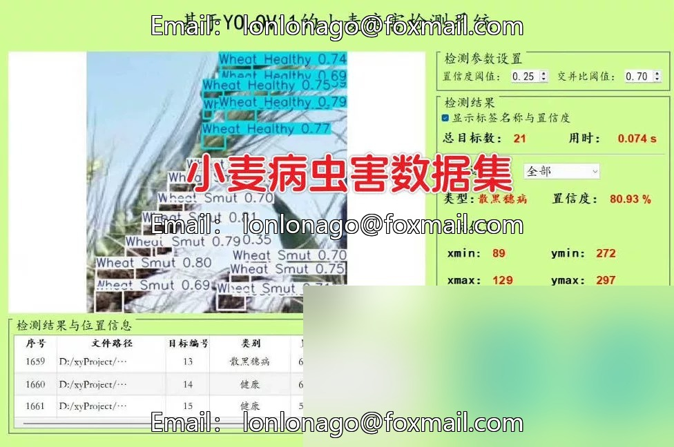
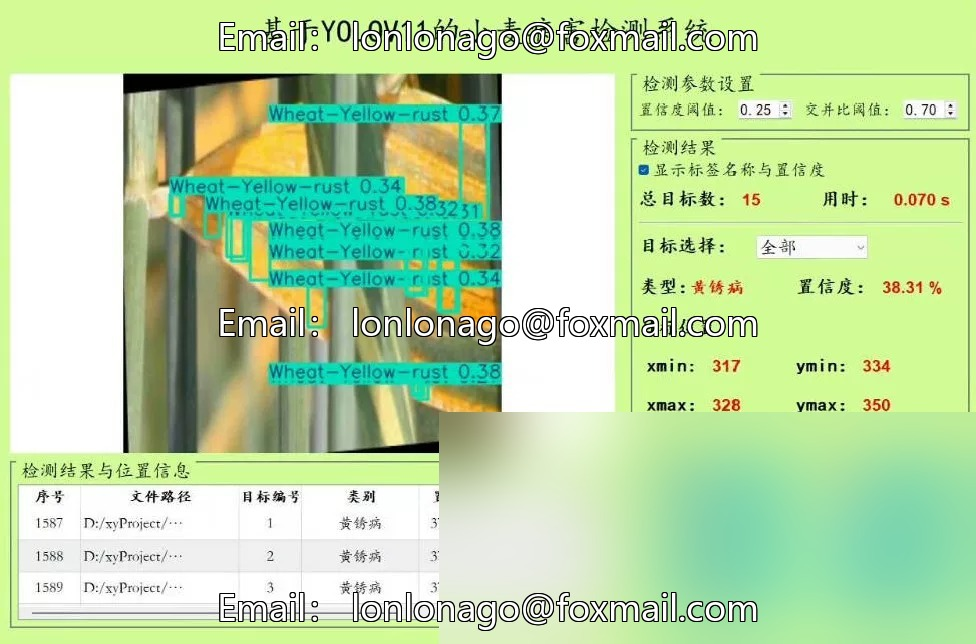
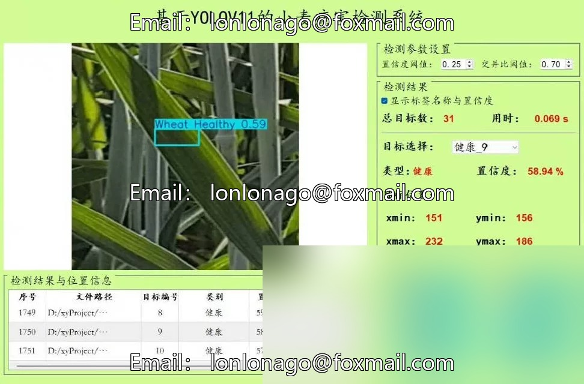
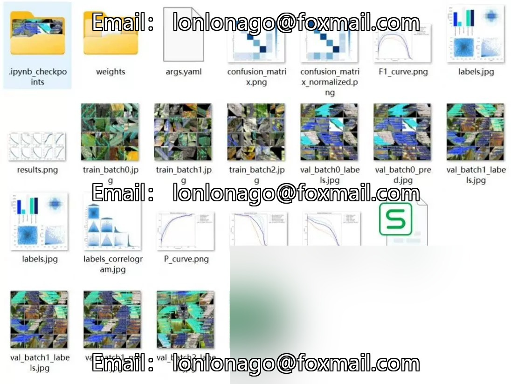

# A YOLOv11+pyqt5 wheat disease detection system

## Body

Based on YOLOv11+pyqt5 wheat disease detection system wheat disease dataset.
The dataset is already annotated, in txt format, in YOLO format, as an object detection dataset. It is suitable for training YOLO5, 7, 8, 9, 10 and other series object detection models. The dataset has been partitioned into training set (1164 images), validation set (218 images), and test set (165 images), including category label description file, divided into 5 categories: leaf rust, healthy, powdery head disease, yellow rust, stem rust. Note that this dataset contains images with data augmentation (original image random angle rotation).

Complete source code source file + annotated dataset + trained model + environment configuration tutorial + program running instruction document
Python + PyQt5 visualization interface
Training set: 1164
Validation set: 218
Test set: 165
Training results with yolov11 500epoch

You can also replace the model yourself and use this interface for other purposes to achieve custom detection of targets.
You can perform recognition on images, videos, and cameras.

web-based shipment, can be directly photographed and shipped.

The dataset includes a wheat disease detection system using YOLOv11 and PyQt5; data is in txt and YOLO format, split into training, validation, and test sets, with source code, model, environment configuration and execution instructions.

<!-- AI_ENRICHED -->

## Images

## Payment

Here is a pay link on Stripe ( https://buy.stripe.com/3cs8yP7sY87d0vu9AB ). Please contact me lonlonago@foxmail.com after funding $89, and I will send you a complete data files , thank you!

